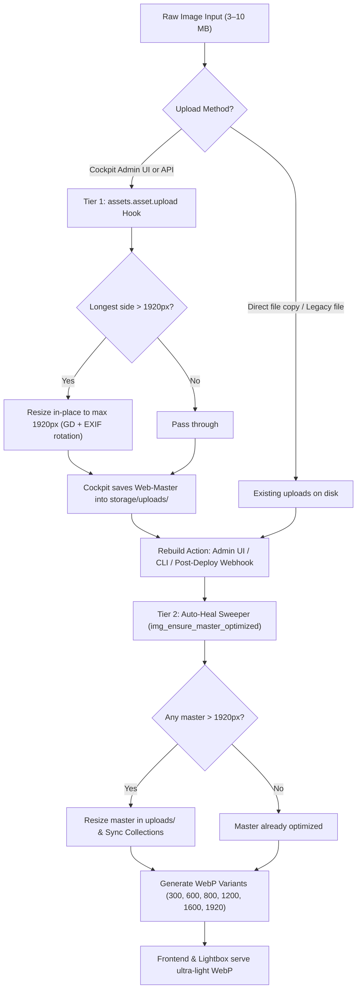

# Amordad - Image Optimization Architecture & Pipeline

This document describes the image optimization architecture, responsive delivery pipeline, and security model for [amordad.backends.ir](https://amordad.backends.ir/).

---

## 1. Overview & Philosophy

Amordad is an architecture and interior design studio portfolio showcasing high-resolution architectural photography, 3D renderings, and detailed site plans.

### The Problem
Raw camera exports and architectural 3D renderings are typically 2560px to 8000px wide, weighing 3 MB to 10 MB each. Storing raw unconstrained files on a shared web server causes:
- Wasted disk quota and inode limits.
- Gigabyte-sized deployment archives and slow backups.
- PHP memory exhaustion (`Fatal: Allowed memory size exhausted`) during image manipulation.
- Accidental bandwidth drain on mobile visitors or high-DPI screens.

### The Solution: Web-Ready Storage & Responsive Delivery
- The server retains lightweight **Web-Master** images (capped at 1920px on the longest side) and pre-calculated **WebP responsive variants** (300–1920px).
- Raw original files remain safely stored locally/in backups.

---

## 2. The 1920px Resolution Ceiling (Longest Side Rule)

The system enforces a **1920px bounding box**:
$$\max(\text{display\_width}, \text{display\_height}) \le 1920$$

- **Landscape Images:** Bounded by width ($1920 \times 1080$, $1920 \times 1280$, etc.).
- **Portrait & Square Images / Diagrams:** Bounded by height ($1080 \times 1920$, $1920 \times 1920$).
- **EXIF Rotation:** JPEG orientation tags (1–8) are evaluated; photos taken with mobile phones or cameras are rotated upright before dimensions are calculated and saved.

---

## 3. The Multi-Tier Ingestion & Healing Pipeline



### Tier 1: Proactive Ingestion Hook
- **File:** `vorud/config/bootstrap.php`
- **Trigger:** Cockpit event `assets.asset.upload`
- **Functionality:** Intercepts temporary files before Cockpit commits them to `vorud/storage/uploads/`. If width or height exceeds 1920px, it rescales the image in-place, updating Cockpit's database attributes (`width`, `height`, `size`, `_hash`).

### Tier 2: Auto-Heal Sweeper
- **Files:** `vorud/config/controllers/ImageOptimization.php`, `tools/warm-images.php`
- **Functionality:** Whenever **Clear Cache & Rebuild All** is clicked in Cockpit Admin, or `tools/warm-images.php` runs, the sweeper evaluates all active assets. Any image that bypassed the upload hook is downscaled in-place and Cockpit collection references are synced automatically before variants are generated.

### Tier 3: Automated Post-Deploy Webhook
- **Files:** `deploy-warmup.php`, `build-deploy-zip.sh`
- **Functionality:** After `build-deploy-zip.sh` completes extracting files on cPanel via API, it sends an automated, authenticated HTTP POST request to `deploy-warmup.php` to pre-generate all WebP variants.

---

## 4. Responsive Frontend Delivery & Breakpoints

| Variant Width | Role / Typical Viewport | Typical WebP Size |
| :--- | :--- | :--- |
| **300px** | Project bottom gallery thumbnails / mobile thumbs | ~10–30 KB |
| **600px** | Project cards in home page & category listings | ~25–50 KB |
| **800px** | Tablet viewport cards & medium tiles | ~50–80 KB |
| **1200px** | Hero headers & full-width desktop content | ~100–160 KB |
| **1600px** | High-DPI screens & medium lightbox previews | ~160–250 KB |
| **1920px** | Full HD & 4K full-bleed Lightbox modal | ~250–380 KB |

---

## 5. Security & Access Control

### Deploy Webhook (`deploy-warmup.php`)
1. **Single-Use Cryptographic Token:** `build-deploy-zip.sh` generates a 256-bit random hex string stored in `vorud/storage/data/.deploy-token`.
2. **Timing Defense:** Validated via `hash_equals()`.
3. **Immediate Self-Destruct:** The token file is unlinked (`@unlink`) upon validation, preventing replay attacks.
4. **Time-Limited:** Tokens expire after 5 minutes.
5. **Headers:** Protected with `X-Robots-Tag: noindex, nofollow` and `Cache-Control: no-store`.

---

## 6. CLI Tools Reference

### Inspect & Downscale Masters
```bash
# Preview oversized assets without modifying files
php tools/optimize-masters.php --dry-run

# Execute in-place downscaling and update database
php tools/optimize-masters.php
```

### Pre-Generate WebP Variants
```bash
# Generate missing responsive WebP copies
php tools/warm-images.php

# Prune cached variants belonging to archived content
php tools/warm-images.php --prune
```

### Deploy to Production
```bash
# Standard automated deployment with post-deploy cache warmup
./build-deploy-zip.sh
```
